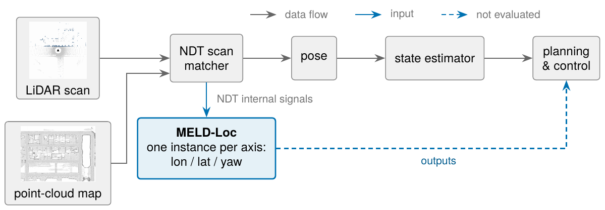
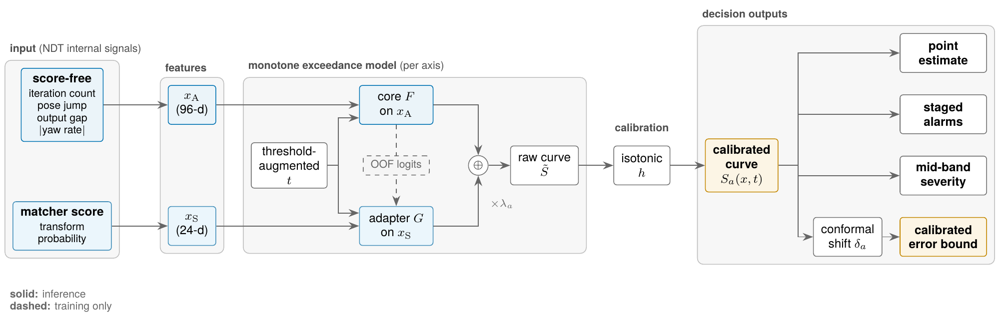
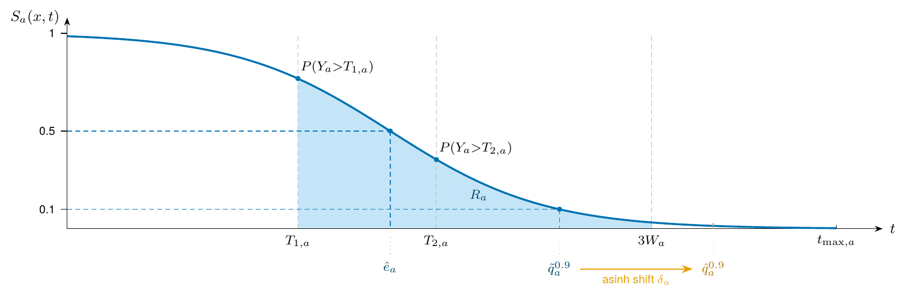
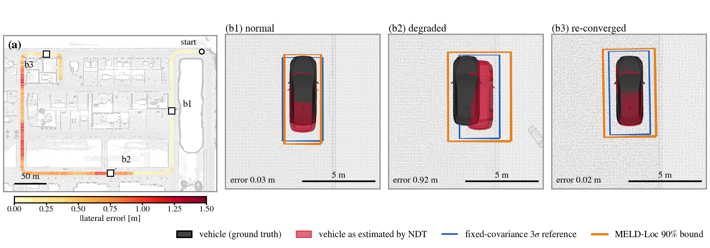
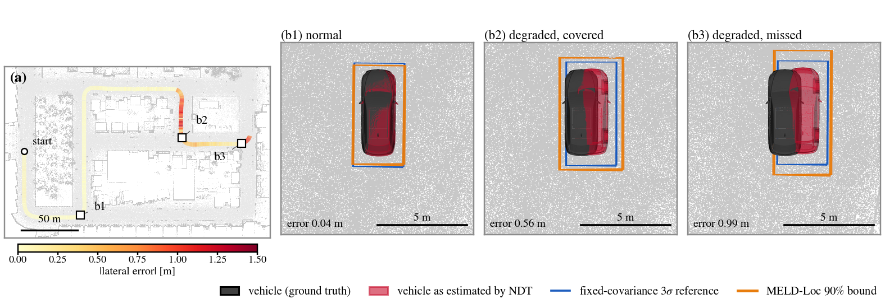

<h1 align="center">MELD-Loc</h1>

<p align="center"><b>Per-axis health assessment for NDT-based LiDAR localization</b></p>

<p align="center">


</p>

## Overview

<p align="center"></p>

Autoware's NDT scan matcher reports its pose with a fixed covariance, so the rest of the stack
cannot tell a healthy match from a drifting one. MELD-Loc attaches one small model per axis
(longitudinal, lateral, yaw) that reads five signals the matcher already produces, with no extra
sensor and no ground truth at run time, and turns them into an exceedance curve: the probability
that the error over the next second exceeds each threshold of a fixed grid. From that curve it
derives a point estimate, staged alarm probabilities at two operational thresholds, a mid-band
severity index and a calibrated error bound targeting 90% marginal coverage. All four outputs are
readings of one monotone curve, so they never contradict each other.

## Method

<p align="center"></p>

The model is a gradient-boosted ensemble trained on threshold-augmented samples under a
monotonicity constraint on the threshold input, so the raw curve is non-increasing by
construction. A matcher-score-free core carries the signal and a small residual adapter adds the
matcher score where it helps. Isotonic calibration and a conformal-style shift, both fitted once
on the development-validation split and then frozen, turn the raw curve into calibrated
probabilities and a one-sided bound.

<p align="center"></p>
<p align="center"><sub>Every output is read off one curve S<sub>a</sub>(x, t): the alarm probabilities at T<sub>1</sub> and T<sub>2</sub>, the point estimate at the 0.5 crossing, the severity index as the shaded area over the mid band, and the bound as the shifted 0.1 crossing.</sub></p>

## Results

Final evaluation on 24 unseen runs (10,827 anchors) of the training route, scored once with the
frozen models:

| axis | bound coverage (target 0.90) | ECE of P(Y > T<sub>1</sub>) | AUROC at T<sub>1</sub> | twIBS, MELD-Loc / Q-multi / K-indep |
|:--|:--:|:--:|:--:|:--:|
| longitudinal | 0.932 | 0.010 | 0.999 | 0.014 / 0.017 / 0.125 |
| lateral | 0.908 | 0.003 | 0.986 | 0.018 / 0.025 / 0.132 |
| yaw | 0.941 | 0.005 | 0.991 | 0.029 / 0.032 / 0.134 |

The raw curves show zero monotonicity violations on every anchor, against 17–46% of adjacent
pairs for per-threshold classifiers and multi-quantile regression. On an unseen route and an
independently built map (Town02, 20 runs) the curves stay valid and marginal coverage stays at
0.90–0.96, but lateral coverage inside the mid band drops to 0.26, so the bound is not
established under route shift in that regime. The matcher's own Hessian-based covariance, once
scaled, discriminates degradation but covers none of the divergent errors. Inference costs about
2 ms per anchor for the three axes on a desktop CPU.

<p align="center"></p>
<p align="center"></p>
<p align="center"><sub>Two runs with the same lateral-shear recipe on the training route (top) and the unseen route (bottom). Ground-truth vehicle in black, NDT estimate in red, fixed 3σ box in blue, MELD-Loc 90% box in orange. The bound grows with the actual error on both routes; the last tile shows a miss on the unseen route.</sub></p>

## Simulation

Runs are generated in CARLA 0.9.15 with the Autoware localization stack (NDT scan matcher, EKF,
error monitor) on a pinned workspace. A perturbation node rewrites every LiDAR scan according to a
recipe (dropout, range clip, sector removal or thinning, rigid translation and rotation,
lateral / longitudinal / yaw shear), scheduled by route progress, while the logger records the
matcher's internal signals and the ground-truth pose at 10 Hz. The 334 runs behind the shipped results cover a
development cohort, an in-route holdout, a cross-route set, speed-profile and high-intensity
stress sets, and runs with the matcher's Hessian covariance output enabled.

## Layout

```
data/indices/   cohort tables, one per role (development, holdout, crossroute, stress, ndt_covariance)
data/logs/      run logs (not in the repository; regenerated with datagen/)
datagen/        CARLA + Autoware scenario runner: generate_<role>.sh, perturbation node, routes, map tools
env/            the pinned Autoware workspace (sub-repository commits, patches, sensor kit), CARLA, maps
models/         feature extraction, the model, training, baselines, evaluation scripts, trained models
results/        result files, one folder per analysis
reports/        LaTeX / markdown summary tables written by models/meldloc/report_tables.py
figures/        plotting scripts
docs/images/    figures for this page
```

## Requirements

Everything was developed and run on one desktop: Ubuntu 22.04, AMD Ryzen 9 9900X (12 cores / 24
threads), 32 GB RAM, NVIDIA RTX 3090 (24 GB).

| what you want to run | needs |
|---|---|
| scoring, tables and figures from the shipped files | Linux or macOS, Python 3.10, about 2 GB RAM; no GPU. The scripts use up to 12 threads (`n_jobs` in `meldloc_core.py`) and simply take longer on fewer cores. On this machine: re-scoring the development split about 2 min, the model-component ablations about 10 min, the seed-variability retraining about 30 min (2 min per seed and axis), the feature-pruning retraining about 70 min (5 min per configuration) |
| rerunning the pipeline from run logs | the above plus run logs (0.9 GB for the original cohorts, which are not in the repository); feature extraction reads every log once (a few minutes) |
| generating new runs | Ubuntu 22.04, ROS 2 Humble, the Autoware workspace of `env/README.md` (about 5 GB built), CARLA 0.9.15 (19 GB) and the two maps (0.9 GB); an NVIDIA GPU for CARLA (run at `-quality-level=Low`, the RTX 3090 is far more than needed). One run takes about 6 min wall-clock including the CARLA restart, so a full role is hours to a day |

## Installation

Python 3.10 with the pinned packages:

```
pip install -r requirements.txt
```

Generating new runs additionally needs ROS 2 Humble, the Autoware workspace described in
`env/README.md`, CARLA 0.9.15 and the two town maps. Copy `env.sh.example` to `env.sh` and set
the paths.

## Usage

Everything after feature extraction runs from the files in `results/` and `models/frozen/`:

```
python3 models/meldloc/report_tables.py          # reports/*.tex, reports/tables.md
python3 models/meldloc/devval_scoring.py         # re-scores the development-validation split (~2 min)
python3 models/meldloc/seed_variability_summary.py
python3 figures/plot_validity.py --lang en       # figures/out/validity_en.{pdf,png,svg}
```

With run logs under `data/logs/` (regenerated with `datagen/`, see Data) the whole pipeline can be rerun:

```
python3 models/features/build_features.py        # logs -> results/features/development_features.npz
python3 models/meldloc/train.py                  # -> models/trained/ (the shipped models in models/frozen/ are kept)
python3 models/meldloc/holdout_eval.py           # -> results/evaluation/holdout_eval.json
python3 models/meldloc/crossroute_eval.py        # -> results/evaluation/crossroute_eval.json
python3 models/meldloc/stress_eval.py            # -> results/stress/
python3 models/meldloc/coverage_timing_analyses.py condcov capraw delay latency   # -> results/coverage/, results/timing/
```

`models/README.md` lists every script with its inputs and outputs.

To generate runs, run one script per role from `datagen/`.
Each reads its cohort table, restarts CARLA before every run and appends to a ledger:

```
cd datagen && ./generate_holdout.sh              # likewise generate_development.sh, _crossroute, _stress, _ndt_covariance
```

CARLA is not deterministic, so regenerated runs follow the same recipes but are not identical to
the original logs.

## Data

Each cohort table in `data/indices/` has one row per run with the executed recipe (perturbation
mode, schedule, sector, seed, speed profile, covariance option) and the run directory. The raw
run logs (about 0.9 GB) and the two maps are not part of this repository; the processed feature
files in `results/features/` are their output, so every analysis after feature extraction runs
without them. A run directory produced by `datagen/` holds the logged matcher signals and ground
truth (`long_route_pilot.csv`), the perturbation log and the executed command line (`commands.txt`).

## License

Apache License 2.0, see `LICENSE`.
